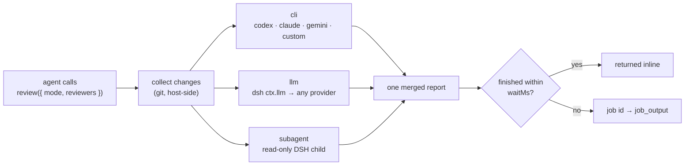

# dsh-review

**English** | [中文](README.zh.md)

[](LICENSE)
[](https://github.com/deepseek-ai/deepseek-harness)
[](#design-notes)
[](#three-kinds-of-reviewer)

One tool — `review` — that hands your diff to whoever you trust to read it: a CLI coding
agent, a model reached through DSH's own provider stack, or a read-only DSH subagent. You
decide in config which reviewers exist, which models they use, and how hard they should
look. Zero runtime dependencies: only `node:` built-ins.



## Table of Contents

- [Why this exists](#why-this-exists)
- [Install](#install)
- [Quick start](#quick-start)
- [Three kinds of reviewer](#three-kinds-of-reviewer)
- [Model discovery](#model-discovery)
- [Configure in the GUI](#configure-in-the-gui)
- [Review modes](#review-modes)
- [Configuration reference](#configuration-reference)
- [How one call runs](#how-one-call-runs)
- [Self-test](#self-test)
- [Design notes](#design-notes)
- [Known limitations](#known-limitations)
- [License](#license)

## Why this exists

`codex exec review` on its own is fine, but an agent running it through the `bash` tool hits
two walls:

1. **Sandbox** — codex reads and writes `~/.codex` (session logs, sqlite, PATH aliases). Under
   the DSH file sandbox that becomes `Operation not permitted` before the review even starts.
2. **Command approval** — `codex` is not on `run_command`'s auto-allow list, so every review
   stops for approval; with approval set to `never` it is simply refused.

This plugin spawns the process from the host side via `ctx.subprocess`, so neither applies.
The command line is assembled by the plugin, and the model can only choose *what to review*
and *which reviewer* — there is no room to inject extra flags.

The same argument generalizes: **any** review needs a reviewer that the calling agent cannot
easily reach. So instead of one hard-coded `codex_review`, this plugin exposes a reviewer
registry, and `review` picks from it.

Reviewing is read-only by design: no `--dangerously-bypass-approvals-and-sandbox`-style
switches are ever emitted, and codex keeps whatever sandbox and approval policy
`~/.codex/config.toml` gives it.

## Install

Clone it somewhere permanent (the profile **symlinks** to this directory — don't delete it,
don't copy it):

```sh
git clone git@github.com:yutingzhao1991/dsh-review.git ~/code/github/dsh-review
```

Then either:

- ask the agent to call `plugin_manager` → `install_bundle` with `target` set to the absolute
  clone path; or
- run `dsh plugin --profile web add ~/code/github/dsh-review` (`web` → your profile name;
  repeat per profile).

A freshly installed bundle takes effect immediately. **After editing `index.js` you must
restart the host process**: the loader uses a plain `import()`, same-path modules are cached
by ESM, and the profile's `hmr.root` is empty by default and does not watch this directory —
toggling the plugin row is not enough. Upgrades behave the same way: `git pull`, then restart.

## Quick start

```yaml
# ~/.dsh/profiles/<profile>/cordis.patch.yml
- id: review
  name: dsh-review
  config:
    agents:
      - preset: codex
        model: gpt-5.6-sol
    models:
      - provider: bailian
        model: qwen3.8-max
        label: Qwen3.8-Max
      - provider: bailian
        model: glm-5.3
    defaultMode: balanced
    modes:
      balanced:
        strength: standard
        reviewers: [ codex, qwen3.8-max ]
      deep:
        strength: deep
        reviewers: [ codex, qwen3.8-max, glm-5.3 ]
        synthesize: true        # merge the reports into one de-duplicated list
```

Then, from the agent:

```js
review()                                            // all enabled reviewers, uncommitted changes
review({ reviewers: ["codex"] })                    // just codex
review({ mode: "deep" })                            // deep strength + synthesis
review({ base: "main" })                            // working tree vs a branch
review({ commit: "abc1234" })                       // one commit
review({ instructions: "only concurrency and error handling" })
```

## Three kinds of reviewer

| Kind | How it runs | Reads the code itself? | Needs | Good for |
| --- | --- | --- | --- | --- |
| `cli` | host-side `ctx.subprocess`, argv from a template | depends on the preset (codex: yes) | the CLI installed | reusing an agent you already trust |
| `llm` | `ctx.llm.stream()` — DSH's own provider stack | no, the plugin feeds it a diff packet | a configured provider + model | a second opinion from a different model, cheaply |
| `subagent` | `ctx.subagents.start()` — a real DSH child agent | yes, it has tools | a subagent provider | a reviewer that can open files, grep, and run read-only commands |

### `cli` presets

| Preset | Executable | argv shape | Captures |
| --- | --- | --- | --- |
| `codex` | `codex` | `exec review {range} --ephemeral -m <model> --output-last-message <file> [-- <prompt>]` | report file |
| `claude` | `claude` | `--print --output-format text [--model <m>] <prompt>` | stdout |
| `gemini` | `gemini` | `-p <prompt> [-m <m>]` | stdout |
| `opencode` | `opencode` | `run [--model <m>] <prompt>` | stdout |
| `cursor` | `cursor-agent` | `--print [--model <m>] <prompt>` | stdout |
| `custom` | yours | your `command` template | `stdout` or `report` |

`codex` uses its **native** `exec review` subcommand: it walks the repo itself, so the plugin
does not feed it a diff. Every other preset gets a *diff packet* — change stat, `git status`,
the full patch, and the text of untracked new files — because it has no git awareness of its own.

Because the codex CLI refuses a `[PROMPT]` next to a range flag, **a range always wins**: when
`base`/`commit` is set, the mode's prompt is not handed to codex (and the report's footnotes
say so) instead of the scope being silently dropped.

Untracked new files count as part of the change only for the **uncommitted** scope. For
`base`/`commit` they belong to neither `git diff <base>` nor `git show <commit>`, so they are
left out of the material and the change size, with a note saying so.

A `custom` reviewer is a template plus placeholders:

```yaml
reviewers:
  - id: my-agent
    kind: cli
    preset: custom
    executable: /opt/bin/my-reviewer
    command: [ "{exe}", "--json", "{model}", "{report}", "{extra}", "{prompt}" ]
    capture: report            # read the conclusion from {report}
    promptVia: argv            # or stdin
    model: my-model
    extraArgs: [ "--strict" ]
```

| Placeholder | Expands to |
| --- | --- |
| `{exe}` | the resolved executable |
| `{range}` | `--uncommitted` / `--base <ref>` / `--commit <sha>` (empty when this preset lets the prompt replace the range) |
| `{model}` | the preset's model flag plus the model id (empty when no model) |
| `{ephemeral}` | `--ephemeral` |
| `{report}` | the path the reviewer should write its conclusion to |
| `{reportArg}` | `--output-last-message <path>` |
| `{prompt}` | the full review prompt (empty when `promptVia: stdin`) |
| `{promptArg}` | `--` followed by the prompt — the codex-native shape |
| `{extra}` | `extraArgs` |

A reviewer is treated as **native** — the prompt replaces the range — when its preset declares
`promptReplacesRange: true` (codex) **or** its template contains `{promptArg}`: those CLIs
refuse `[PROMPT]` together with `--uncommitted`/`--base`/`--commit`, and a custom wrapper around
codex is written exactly that way. Every other template keeps its range flags *and* the prompt.

### `llm` reviewers

The plugin runs git itself, builds a size-budgeted packet, and calls the model through
`ctx.llm` — the same service the agent loop uses. The model answers with text only; it needs
no tool permissions and no repo access.

```yaml
models:
  - provider: bailian           # any provider registered with dsh-llm
    model: qwen3.8-max
    label: Qwen3.8-Max
    llm:
      maxTokens: 8192
      temperature: 0
```

The stream is consumed by the plugin directly (`text-delta` chunks plus the terminal
`finish`), so no `@deepseek-ai/dsh-llm` import and no version coupling.

#### Where the model list comes from

**DSH's provider configuration, never this plugin.** A reviewer only ever *references* a
`provider` + `model` by name; endpoints, credentials, context windows and image support all
stay in your DSH config (`dsh-llm-pi-ai`, `dsh-llm-deepseek`, …). The plugin holds no API key,
no `baseURL`, and no `fetch`.

That means you don't have to re-declare every model here. Two ways to use what DSH already has:

```js
review({ reviewers: ["bailian/kimi-k3"] })   // name any registered model directly
review({ reviewers: ["kimi-k3"] })           // bare model id, when it is unambiguous
```

`provider/model` naming is on by default (`discover.adHoc`). The plugin asks `ctx.llm` whether
that route exists before using it, so an unregistered name fails loudly instead of silently
falling back — the error lists what DSH *does* have.

To go further and have a provider's models show up as first-class reviewers, turn on
discovery:

```yaml
config:
  discover:
    providers: [ bailian ]                  # scoping key: writing it turns discovery on
    exclude: [ "*embedding*", "*rerank*" ]  # never expanded, and refused ad hoc
    include: [ "qwen*", "glm*" ]            # optional allowlist
    label: "{providerName}/{model}"         # {provider} {providerName} {model} {name}
    inDefault: false                        # keep them out of the default set
    adHoc: true                             # allow provider/model naming
```

Discovered reviewers are named `provider/model`, get the label from `label`, and are marked
**自动发现** (auto-discovered) in the report; ad-hoc ones are marked **按需指名** (named on
demand). Resolution happens per call, so adding or removing a model in DSH takes effect
immediately — there is no stale copy in this plugin to update.

### `subagent` reviewers

Starts a DSH child agent through `ctx.subagents`. It receives the same review packet in its
prompt, **and** keeps its tools, so it can open files and check call sites the diff alone
does not show.

```yaml
reviewers:
  - id: deep-dive
    kind: subagent
    provider: spawn                       # the ctx.subagents provider name
    agentProvider: bailian
    agentModel: deepseek-v4.1-flash
    label: DSH subagent
    maxDepth: 1
    persona: "You are a meticulous reviewer."
    toolFilter: { ... }                   # passed through to the subagent request
```

## Model discovery

The reviewer list and the model list are two different things. This plugin owns only the
first one:

| | Owner | Examples |
| --- | --- | --- |
| **Definition** — endpoint, credential, context window, modalities | your DSH provider config | `bailian` → `baseURL`, `apiKeyEnv: BAILIAN_API_KEY`, `models: [...]` |
| **Selection** — which ones are reviewers, their ids, labels, defaults | this plugin's `config` | `reviewers: [{ id: qwen, provider: bailian, model: qwen3.8-max }]` |

So the plugin never stores a key, never talks to a provider endpoint, and never has a model
list that can go stale. `ctx.llm.listProviders()` / `listModels(provider)` are the only source
of truth, queried per call.

| `discover` key | Default | Meaning |
| --- | --- | --- |
| `enabled` | follows the scoping keys | expand discovered models into reviewers |
| `providers` | all registered | which providers to expand (a scoping key: writing it enables discovery) |
| `include` | `[]` | allowlist globs, matched against `provider/model` **and** the bare model id |
| `exclude` | `[]` | denylist globs — never expanded, and refused when named ad hoc |
| `label` | `{model}` | label template: `{provider}`, `{providerName}`, `{model}`, `{name}` |
| `inDefault` | `false` | whether discovered reviewers join the default set |
| `adHoc` | `true` | allow `reviewers: ["bailian/kimi-k3"]` without any config entry |
| `listModelsTimeoutMs` | `8000` | per-provider budget for fetching the model list; a slow provider is skipped, not fatal |

Resolution rules, in order:

1. an exact reviewer id from your config;
2. a bare model id, **if exactly one** reviewer uses it (ambiguous names are never guessed);
3. `provider/model`, if `adHoc` is on and DSH actually registers that route.

Nothing is invented: a name that matches none of these produces an error listing the
configured reviewers *and* the models DSH has registered right now.

If your config contains **only** `discover` and no static reviewers, the discovered set
becomes the default — otherwise "call `review()` with no arguments" would mean nothing.

## Configure in the GUI

You do not have to hand-edit YAML. Open **Plugins** in the Web sidebar, pick **dsh-review**,
and open its row (or the bundle card): that page renders a form for this plugin's config, and
it prefers selection over typing.

The page is ordered by what you reach for first:

| Section | Contents |
| --- | --- |
| **Enabled reviewers** (top) | one row per defined reviewer: a switch, its id, and what it points at (`cli · codex`, `llm · bailian/qwen3.8-max`). Checking a row is how that reviewer gets used by default, and the list is drawn only from the definitions below. |
| **Reviewer definitions** | structured editor: add/remove rows, pick `kind` from a segmented control, and pick **provider / model from the live host catalog** — no model names to type |
| **Advanced settings** (collapsed by default) | review behaviour (language, policy injection, default mode), review modes, model discovery (switches, a provider multi-select fed by the host catalog, glob lists, label template), and budgets/timeouts pre-filled with the values actually in effect |

**Nothing checked means no reviewers are enabled.** A bare `review()` call then fails with a
message telling you to check something or pass `reviewers` explicitly — an empty selection is
never read as “use everything”.

Things worth knowing:

- **Provider and model lists come from DSH itself.** The page asks the host for its model
  catalog (`remote.session.modelCatalog`), so a reviewer's model is a dropdown over what your
  DSH providers actually serve. If that catalog cannot be read, those controls degrade to text
  inputs and the page says so.
- **Reviewers and modes are structured editors with a JSON escape hatch.** Nested structures
  have no generic form control in DSH, so the page renders its own row editors (add/remove,
  per-field controls) and writes the result back as the same JSON value the YAML uses. A
  collapsible **Show raw JSON** control edits that value directly; malformed JSON or a missing
  reviewer `id` blocks the save with an explanation.
- **Keys the form does not cover stay in YAML** — `agents`, `models`, `envPassthrough`, and
  anything else outside the exposed field set. The profile config remains the source of truth;
  a save just rewrites the exposed keys.
- **Saving** goes through DSH's own settings machinery: the edit lands in the profile patch
  (`cordis.patch.yml`) and is applied immediately, with conflict detection if the document moved
  under you. Editors stage their changes and write once on **Save**; leaving discards a draft.

Under the hood the host half declares a [schemastery](https://github.com/shigma/schemastery)
`Config` schema whose fields are marked `.volatile()`, because `dsh-settings` only projects
volatile fields into a form. The browser half (`client/client.js`) registers that form on the
Plugin page's own configuration slots and builds on DSH's `SettingsForm` / `SettingsFormModel`
primitives, so staging, saving, and conflict handling match the official settings pages.

If schemastery cannot be resolved at load time (the plugin is linked, so Node resolves imports
from the repo directory rather than the profile), the plugin still works — there is simply no
GUI form, and the tool description says so.

## Review modes

A **mode** is a named bundle of: how hard to look (`strength`), what to say (`prompt`), who to
use (`reviewers`), and whether to merge the results (`synthesize`).

| Field | Type | Meaning |
| --- | --- | --- |
| `strength` | `light` \| `standard` \| `deep` | built-in framing appended to the reviewer's system prompt |
| `prompt` | string | your own review instructions for this mode (also reaches codex as its `PROMPT`) |
| `reviewers` | string[] | overrides the reviewer set for this mode |
| `synthesize` | boolean | after the reviewers finish, ask one `llm` reviewer to merge their findings |
| `synthesizeReviewer` | string | which `llm` reviewer does the merging (default: the first selected one) |
| `when` | `always` \| `complex` \| `never` | review policy, used only when `injectPolicy: true` |
| `minChangedLines` | number | threshold quoted by the `complex` policy text |
| `label`, `description` | string | shown in the tool description |

### Default: no policy at all

The plugin does **not** decide when review is mandatory. With no `modes` and no `injectPolicy`,
it adds nothing to the system prompt and the tool description simply says "no modes are
configured" — you constrain the agent with your own prompt, skills, or `AGENTS.md`, whichever
you already use. That is the intended default.

If you *do* want the rule stated in the system prompt, set `injectPolicy: true` and give a
mode a `when`:

```yaml
config:
  injectPolicy: true
  defaultMode: gated
  modes:
    gated:
      when: complex              # or: always / never
      minChangedLines: 50
```

- `always` — “every change must pass through `review` before the task is called done.”
- `complex` — “concurrency, error handling, security, migrations, public interfaces, build
  config, or anything too large to describe in one commit needs review; copy edits do not.”
- `never` — explicitly optional.

This is **guidance in the system prompt, not a hard gate**: the plugin never blocks a turn.
A real gate would have to intercept tool calls, which is a different product decision.

## Configuration reference

Every key is optional; defaults live in `lib/settings.js`.

| Key | Default | Meaning |
| --- | --- | --- |
| `agents` | `[]` | shorthand list of `cli` reviewers; `id` defaults to the preset name |
| `models` | `[]` | shorthand list of `llm` reviewers; `id` defaults to the model name |
| `reviewers` | `[]` | full reviewer definitions (see below); wins over a shorthand with the same id; GUI-editable as JSON |
| `discover` | `{ enabled: false, adHoc: true, … }` | pull models straight from DSH's provider config instead of re-declaring them (see [Model discovery](#model-discovery)); editable in the GUI |
| `defaultReviewers` | **none** | reviewer ids used when a tool call omits `reviewers`. Empty means **no reviewers are enabled** and such a call fails loudly — it is never read as “all enabled”. Set it in the GUI's top list or in YAML |
| `defaultMode` | none | mode applied when the tool call does not pass `mode`; editable in the GUI |
| `modes` | `{}` | named review modes; GUI-editable as JSON |
| `injectPolicy` | `false` | write each mode's `when` rule into the system prompt; editable in the GUI |
| `language` | `auto` | `zh` / `en` / `auto` — output language (`auto` follows `instructions`, Chinese when there is none); editable in the GUI |
| `waitMs` | `120000` | how long the tool blocks before handing back a job id; `0` = return immediately |
| `hardTimeoutMs` | **`0`** | fallback wall-clock ceiling; `0` = unlimited (the default) — how long a review may run is the caller's call (wait for the job, or `job_kill` it) |
| `maxResultChars` | `80000` | cap on the report returned to the model; longer reports are head/tail truncated with a path to the full file |
| `maxDiffChars` | `160000` | cap on the diff packet fed to `llm`/`subagent`/packet-based CLI reviewers |
| `maxFileDiffChars` | `40000` | per-file diff cap |
| `maxDiffFiles` | `60` | at most this many files enter the diff |
| `maxUntrackedFileChars` | `20000` | per-file cap when reading untracked new files |
| `maxArgBytes` | `98304` | single-argument byte cap for CLI reviewers that receive the prompt through `argv` (Linux allows ~128 KiB per argument; without this, a large diff fails to spawn) |
| `collectMaxBytes` | `262144` | retained bytes of reviewer stdout/stderr (diagnostics only) |
| `spillMaxBytes` | `8388608` | spill-file cap for that output |
| `envPassthrough` | `[]` | extra environment variables to forward to reviewer processes (the subprocess service scrubs `KEY`/`PASSWORD`/`SECRET`/`TOKEN`-shaped names) |

Reviewer fields — `kind` may be omitted in `reviewers` and is inferred from which keys you
used (`preset`/`executable`/`command` → `cli`, `provider` → `llm`, `subagentProvider`/
`agentModel` → `subagent`).

<details>
<summary><b>Full config example</b></summary>

```yaml
- id: review
  name: dsh-review
  config:
    language: auto
    waitMs: 180000
    maxResultChars: 60000
    defaultReviewers: [ codex, qwen ]
    defaultMode: balanced
    injectPolicy: true

    # Pull models straight from DSH instead of re-declaring them here.
    discover:
      providers: [ bailian ]
      exclude: [ "*embedding*", "*rerank*" ]
      adHoc: true

    agents:
      - preset: codex
        model: gpt-5.6-sol
        timeoutMs: 1800000
      - preset: claude
        executable: /opt/homebrew/bin/claude
        extraArgs: [ "--allowedTools", "Read,Grep,Glob" ]
        enabled: false

    models:
      - provider: bailian
        model: qwen3.8-max
        label: Qwen3.8-Max
        llm: { maxTokens: 8192, temperature: 0 }
      - provider: bailian
        model: glm-5.3
        label: GLM-5.3

    reviewers:
      - id: deep-dive
        kind: subagent
        provider: spawn
        agentProvider: bailian
        agentModel: deepseek-v4.1-flash
        enabled: false

    modes:
      quick:
        label: Quick
        strength: light
        reviewers: [ qwen ]
      balanced:
        strength: standard
        reviewers: [ codex, qwen ]
        when: complex
        minChangedLines: 50
      deep:
        label: Deep
        strength: deep
        description: "every reviewer plus a merged verdict"
        reviewers: [ codex, qwen, glm-5.3 ]
        synthesize: true
        synthesizeReviewer: qwen
        when: always
```

</details>

## How one call runs

1. **Validate** — `base` / `commit` / `instructions` are mutually exclusive, ranges may not
   start with `-` (git would read them as flags), `reviewers` must be a string array.
2. **Resolve** — tool call's `reviewers` → the mode's `reviewers` → `defaultReviewers`, plus
   discovery and ad-hoc names when enabled. An empty outcome is an error, not “everything”.
   Then the working directory (`exec.agent.session.header.cwd`).
3. **Collect** — always: `git status --porcelain -z -uall` and `--numstat`. Only when a
   selected reviewer needs it: the full patch and the contents of untracked files, trimmed to
   the configured budget with an explicit note about what was omitted.
4. **Fan out** — every reviewer runs in parallel, each with its own abort controller and
   timeout. One reviewer failing never fails the others.
5. **Merge** — one report: scope header, one section per reviewer (kind, target, duration,
   failure badge, diagnostics in a `<details>` block), the optional synthesis, and footnotes
   for material notes and config warnings.
6. **Return** — the whole thing goes into a `ctx.jobs` job *and* is returned inline if it
   finishes within `waitMs`. Otherwise the tool returns the job id and the agent collects it
   with `job_output` / `job_kill`; the job registry notifies the originating session when it
   settles. `job_output` and the inline result are byte-identical because the ring holds only
   the report — never the reviewer's progress logs, which can be hundreds of kilobytes of
   dumped diff.

The tool result is a small canonical object; the UI shows it as a terminal card titled
`review(codex,qwen) --uncommitted`.

| Output field | Meaning |
| --- | --- |
| `kind` | `completed` (settled) or `running` (job id handed back) |
| `report` | the merged report text |
| `jobId` | present when `kind: running` |
| `status`, `detail` | job status and the `n/m reviewers finished` summary |
| `reviewers` | the reviewer ids that were used |

## Self-test

`selftest.mjs` drives the plugin with a fake `ctx`: no host process, no real codex, no real
model. 150+ assertions cover config normalization, all three reviewer kinds, git collection,
orchestration, synthesis, truncation, and the regressions found by this plugin's own first
real review.

```sh
node selftest.mjs
```

## Design notes

- **Zero dependencies.** Only `node:fs`, `node:os`, `node:path` and the host services. The LLM
  stream is consumed field by field instead of importing `@deepseek-ai/dsh-llm`, so a DSH
  upgrade cannot break this plugin through a peer version.
- **Bad config is loud but not fatal.** A malformed reviewer entry is dropped with a warning
  that shows up in the tool description and in the report footer; only numbers and enums fall
  back silently.
- **argv only, never a shell.** Reviewer commands are template-expanded arrays given to
  `ctx.subprocess`; `base`/`commit` are validated as revisions, not as text.
- **The diff is the material.** Feeding a diff to a model *is* granting it read access to
  those files. Keep that in mind for private repositories.

## Known limitations

- The working directory is always the **session** working directory
  (`exec.agent.session.header.cwd`); you cannot point a review at another repository.
- One call reviews one scope (uncommitted / base / commit), matching the underlying CLIs.
- `base`/`commit` and `instructions` are mutually exclusive — a codex CLI constraint applied
  to every reviewer so the parameters mean the same thing everywhere. Use a mode's `prompt`
  to attach focus to a range.
- Because codex refuses a `PROMPT` next to a range flag, a mode's prompt reaches codex only
  when no `base`/`commit` is given. The range itself is always preserved, and the report notes
  when the prompt was skipped; every other reviewer kind always receives it.
- When a report is truncated, the full text stays in `$TMPDIR/dsh-review-*/report.md` and is
  never garbage-collected. Non-truncated runs delete their temp directory.
- codex only runs inside its trusted directories (`~/.codex/config.toml` → `[projects.*]`);
  the plugin deliberately does not pass `--skip-git-repo-check`, because that trust gate is
  codex's to open, not ours.
- Discovered and ad-hoc reviewers are resolved at call time, so a model you delete from DSH
  disappears from the reviewer set on the next call (that is the point — no stale copy).
- `discover` expands whatever `listModels()` reports. A provider that reports hundreds of
  models will make the tool description and default set unwieldy; use `include`/`exclude`.
- DSH has no generic nested-object control, so the GUI renders its own row editors for `reviewers` / `modes` and keeps a raw-JSON fallback instead of a schema-driven form.
- Reviewers are opt-in: with nothing selected the tool refuses to run rather than falling back to every enabled reviewer.
- `when` is a system-prompt statement of policy, not an enforcement gate.

## License

[MIT](LICENSE)

---

Forked from [dsh-codex-review](https://github.com/yutingzhao1991/dsh-codex-review), which
established the host-side-subprocess + background-job pattern this plugin still uses.