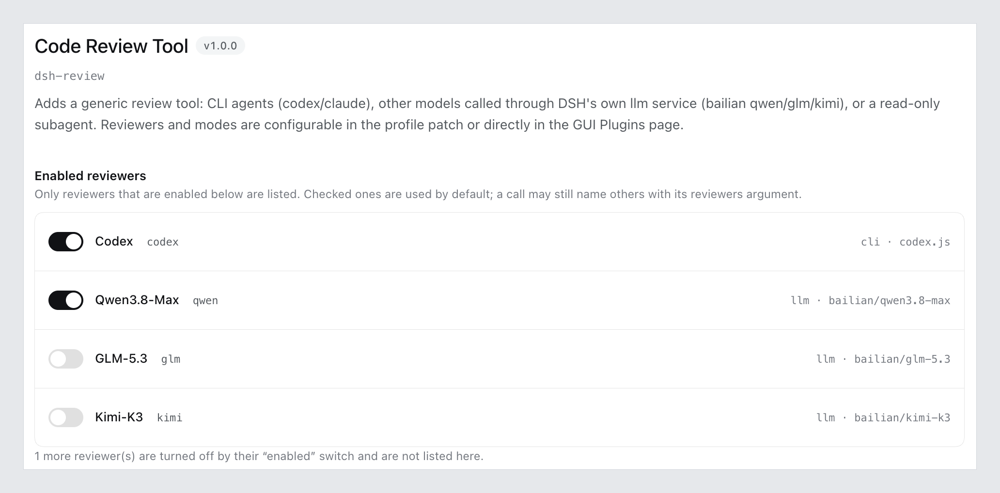

# dsh-review

**English** | [中文](README.zh.md)

[](LICENSE)
[](https://github.com/deepseek-ai/deepseek-harness)
[](#install)

Code review as a tool, not a single vendor. Hand your diff to a CLI coding agent, or to a
subagent running a model from your DSH configuration — then read one merged report.



## What it gives you

- **Two kinds of reviewer, both real agents.** `codex` / `claude` / `gemini` / `opencode` /
  `cursor` / any CLI you template yourself, or a DSH subagent running a model from your DSH
  configuration.
- **Several reviewers, one report.** They run in parallel; each gets its own section, in the
  order they were selected.
- **Review modes.** Name a strength and a prompt once (`quick`, `balanced`, `deep`, …) and reuse
  it, instead of retyping review instructions every time.
- **Configured in the GUI, and saved for you.** Tick the reviewers you want; everything else
  stays collapsed under advanced settings. Edits are written about half a second after you stop
  typing — a status line at the top says where they stand, and a **Save now** button remains as a
  manual retry.
- **No keys, no endpoints.** Providers and credentials stay in your DSH config — this plugin
  only asks for what is already there.

## Install

Clone it somewhere permanent, then install it into a profile:

```sh
git clone git@github.com:yutingzhao1991/dsh-review.git ~/code/github/dsh-review
dsh plugin --profile web add ~/code/github/dsh-review     # web → your profile name
```

Or ask your agent to run `plugin_manager` → `install_bundle` with that absolute path.

Restart the host afterwards. Updating works the same way: `git pull`, then restart.

## Use

```js
review()                                          // the reviewers you enabled, uncommitted changes
review({ reviewers: ["codex", "deep-dive"] })     // pick reviewers for this call
review({ mode: "deep" })                          // deep strength, several reviewers
review({ base: "main" })                          // working tree vs a branch
review({ commit: "abc1234" })                     // one commit
review({ instructions: "only concurrency and error handling" })
```

Reviewing takes minutes, so the call waits a little and then hands back a job id: read the
result with `job_output`, stop it with `job_kill`, or just wait — you are notified when it
settles.

Reviewers are opt-in: if nothing is enabled, a call with no `reviewers` fails and says so
rather than quietly running everything.

## Reviewers

| Kind | What runs | Reads the code itself | Needs |
| --- | --- | --- | --- |
| `cli` | a coding agent you already trust | depends on the preset (codex reads the repo) | that CLI installed |
| `subagent` | a DSH child agent | yes, it has tools | a subagent provider |

CLI presets: `codex`, `claude`, `gemini`, `opencode`, `cursor`, or `custom` with your own
command template.

One thing worth knowing: a `subagent` inherits the parent session's model unless you set
`agentModel`, so it is **not** automatically a second opinion — name the model explicitly if you
want one.

Subagents get two safety nets by default: the `review` tool itself is filtered out (so a reviewer
cannot start more reviews) and a 30-minute wall-clock ceiling applies (`timeoutMs` per reviewer;
`hardTimeoutMs` still caps the whole call). Progress is reported while they run, so a long review
does not look stuck.

There is deliberately no "send the diff to a bare model" kind: a reviewer that can open the
repository itself is worth more than one that only sees what it was handed.

```yaml
- id: review
  name: dsh-review
  config:
    agents:
      - preset: codex
        model: gpt-5.6-sol
      - preset: claude
    reviewers:
      - id: deep-dive
        kind: subagent
        provider: spawn
        agentProvider: bailian      # any provider from your DSH config
        agentModel: deepseek-v4.1-flash
```

A subagent's model comes from your DSH configuration (provider, key, context window), and the
GUI offers the registered ones as a list — nothing is duplicated in this plugin.

## Review modes

A mode bundles how hard to look, what to say, and who to use.

| Field | Meaning |
| --- | --- |
| `strength` | `light` / `standard` / `deep` — built-in review framing |
| `prompt` | extra instructions for this mode |
| `reviewers` | which reviewers this mode uses |
| `when` | `always` / `complex` / `never` — a review policy for the agent to follow |

```yaml
config:
  defaultMode: balanced
  modes:
    balanced:
      strength: standard
      reviewers: [ codex ]
    deep:
      strength: deep
      reviewers: [ codex, deep-dive ]
```

With no modes configured the plugin adds no constraints at all — you keep steering the agent
with your own prompt. `when` only takes effect if you also set `injectPolicy: true`, and it is
stated in the system prompt, not enforced as a gate.

## Configuration

Everything can be set in the GUI; these are the same knobs in YAML. Only the ones worth
knowing:

| Key | Default | Meaning |
| --- | --- | --- |
| `defaultReviewers` | none | reviewers used when a call omits `reviewers`; empty means none are enabled |
| `defaultMode` | none | mode applied when a call omits `mode` |
| `language` | `auto` | `zh` / `en` / `auto` report language (`auto` follows your instructions) |
| `injectPolicy` | `false` | state each mode's `when` rule in the system prompt |
| `agents` / `reviewers` | `[]` | define CLI and subagent reviewers (`agents` is the preset shorthand, `reviewers` the full form) |
| `modes` | `{}` | named review modes |
| `waitMs` | `0` | how long a call blocks before handing back a job id. `0` returns immediately (reviews take minutes, so waiting rarely pays) |
| `hardTimeoutMs` | `0` | wall-clock ceiling; `0` = no limit — you decide when to stop it |
| `maxResultChars` | `80000` | report cap; longer reports are truncated with a path to the full file |
| `maxDiffChars` | `160000` | diff cap for reviewers that receive the diff |

## Known limitations

- Reviews always run in the **session's working directory**; you cannot point them elsewhere.
- One call reviews one scope (uncommitted / a base branch / a commit), matching the underlying
  CLIs. `base` and `commit` are mutually exclusive. A range plus `instructions` works for
  subagents but not for the codex CLI (its range flag and PROMPT exclude each other): if every
  selected reviewer is such a CLI the call is rejected up front, otherwise the CLI ones are named
  in the report footnotes — put the focus
  in a mode's `prompt` instead.
- A mode's prompt reaches codex only when no range is given (its CLI refuses both at once); the
  range is always honoured, and the report says when the prompt was skipped.
- codex only runs inside the directories it trusts (`~/.codex/config.toml`).
- An invalid `base`/`commit` fails before any reviewer starts, instead of running for minutes and
  reporting a batch that reviewed nothing.
- Report scaffolding (headings, footnotes, errors) is Chinese; `language` only controls the
  reviewers' own instructions.
- Truncated reports stay in `$TMPDIR/dsh-review-*/report.md`; other runs clean up after
  themselves.

## Development

```sh
node selftest.mjs    # drives the plugin with a fake host: no DSH, no codex, no model calls
```

## License

[MIT](LICENSE)