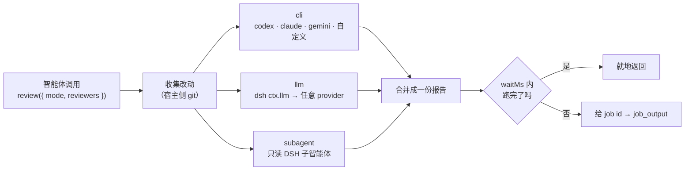

# dsh-review

[English](README.md) | **中文**

[](LICENSE)
[](https://github.com/deepseek-ai/deepseek-harness)
[](#设计取舍)
[](#三种评审者)

一个工具 —— `review` —— 把你的改动交给你信得过的人来读：CLI 编码智能体、DSH 自己
provider 栈里的模型，或者一个只读的 DSH 子智能体。**暴露哪些评审者、用哪个模型、盯得
多严**，全部写在 config 里。零运行时依赖，只用 `node:` 内置模块。



## 目录

- [为什么要有它](#为什么要有它)
- [安装](#安装)
- [快速开始](#快速开始)
- [三种评审者](#三种评审者)
- [评审模式](#评审模式)
- [配置项](#配置项)
- [一次调用是怎么跑的](#一次调用是怎么跑的)
- [自测](#自测)
- [设计取舍](#设计取舍)
- [已知限制](#已知限制)
- [License](#license)

## 为什么要有它

`codex exec review` 自己跑没问题，但让智能体通过 `bash` 工具跑会撞两堵墙：

1. **沙箱** —— codex 要读写 `~/.codex`（会话日志、sqlite、PATH 别名）。在 DSH 文件沙箱下
   会直接 `Operation not permitted`，评审还没开始就失败。
2. **命令审批** —— `codex` 不在 `run_command` 的自动放行清单里，每次评审都要过一遍审批；
   审批关成 `never` 时直接被拒。

这个插件把进程交给宿主侧的 `ctx.subprocess` 起，两者都不经过；命令行由插件拼装，模型只能
选「评审哪个范围」和「用哪个评审者」，没有注入别的开关的余地。

这个理由可以推广：**任何**评审都需要一个调用方不方便直接够到的评审者。所以这里不是一个写死
的 `codex_review`，而是一张评审者注册表，`review` 从里面挑。

评审本身是只读的：**刻意不暴露** `--dangerously-bypass-approvals-and-sandbox` 这类开关，
codex 自己的沙箱与审批策略仍按用户 `~/.codex/config.toml` 走。

## 安装

clone 到你想长期保留的位置（profile 会**软链**到这个目录，别删也不用拷）：

```sh
git clone git@github.com:yutingzhao1991/dsh-review.git ~/code/github/dsh-review
```

然后二选一：

- 让智能体调 `plugin_manager` 的 `install_bundle`，`target` 传 clone 出来的**绝对路径**；
- 或命令行 `dsh plugin --profile web add ~/code/github/dsh-review`（`web` 换成你的 profile
  名；每个 profile 各装一次）。

新装的 bundle 立刻生效。**但改完 `index.js` 后必须重启宿主进程**：加载器用的是普通
`import()`，同路径的模块被 ESM 缓存，而 profile 的 `hmr.root` 默认为空、并不监听这个目录
——单靠启停 plugin row 不会重新求值。升级同理：`git pull` 之后重启。

## 快速开始

```yaml
# ~/.dsh/profiles/<profile>/cordis.patch.yml
- id: review
  name: dsh-review
  config:
    agents:
      - preset: codex
        model: gpt-5.6-sol
    models:
      - provider: bailian
        model: qwen3.8-max
        label: Qwen3.8-Max
      - provider: bailian
        model: glm-5.3
    defaultMode: balanced
    modes:
      balanced:
        strength: standard
        reviewers: [ codex, qwen3.8-max ]
      deep:
        strength: deep
        reviewers: [ codex, qwen3.8-max, glm-5.3 ]
        synthesize: true        # 把多份结论合并、去重成一份清单
```

然后智能体这边：

```js
review()                                            // 全部启用的评审者，评审未提交的改动
review({ reviewers: ["codex"] })                    // 只要 codex
review({ mode: "deep" })                            // 深度强度 + 汇总
review({ base: "main" })                            // 工作区相对某个分支的改动
review({ commit: "abc1234" })                       // 某个提交引入的改动
review({ instructions: "只看并发与错误处理" })
```

## 三种评审者

| kind | 怎么跑 | 自己会读代码吗 | 依赖 | 适合 |
| --- | --- | --- | --- | --- |
| `cli` | 宿主侧 `ctx.subprocess`，argv 由模板展开 | 看预设（codex：会） | 本机装了那个 CLI | 复用你already信得过的编码智能体 |
| `llm` | `ctx.llm.stream()` —— DSH 自己的 provider 栈 | 不会，插件喂它 diff 包 | 配好的 provider + 模型 | 用另一个模型便宜地拿第二意见 |
| `subagent` | `ctx.subagents.start()` —— 真正的 DSH 子智能体 | 会，它有工具 | 一个 subagent provider | 需要翻文件、grep、跑只读命令的评审 |

### `cli` 预设

| 预设 | 可执行文件 | argv 形态 | 结论来源 |
| --- | --- | --- | --- |
| `codex` | `codex` | `exec review {range} --ephemeral -m <model> --output-last-message <file> [-- <prompt>]` | 报告文件 |
| `claude` | `claude` | `--print --output-format text [--model <m>] <prompt>` | stdout |
| `gemini` | `gemini` | `-p <prompt> [-m <m>]` | stdout |
| `opencode` | `opencode` | `run [--model <m>] <prompt>` | stdout |
| `cursor` | `cursor-agent` | `--print [--model <m>] <prompt>` | stdout |
| `custom` | 你指定 | 你的 `command` 模板 | `stdout` 或 `report` |

`codex` 走它**原生**的 `exec review` 子命令：它自己会遍历仓库，所以插件不喂 diff。其他预设
拿到的是一个 **diff 包** —— 变更统计、`git status`、完整 patch、未跟踪新文件的正文 —— 因为
它们自己不认识 git。

因为 codex CLI 不接受范围开关旁边的 `[PROMPT]`，**范围永远优先**：指定了 `base`/`commit` 时，
模式的提示词就不传给 codex（报告脚注会写明这件事），而不是悄悄把范围丢掉。

未跟踪的新文件只算进**未提交**这个范围。对 `base`/`commit` 来说，它们既不在
`git diff <base>` 里也不在 `git show <commit>` 里，所以既不进材料也不进变更规模，只留一条
说明。

`custom` 评审者就是一个模板加占位符：

```yaml
reviewers:
  - id: my-agent
    kind: cli
    preset: custom
    executable: /opt/bin/my-reviewer
    command: [ "{exe}", "--json", "{model}", "{report}", "{extra}", "{prompt}" ]
    capture: report            # 从 {report} 读结论
    promptVia: argv            # 或 stdin
    model: my-model
    extraArgs: [ "--strict" ]
```

| 占位符 | 展开成 |
| --- | --- |
| `{exe}` | 解析出来的可执行文件 |
| `{range}` | `--uncommitted` / `--base <ref>` / `--commit <sha>`（该预设允许 PROMPT 取代范围时为空） |
| `{model}` | 预设的模型开关 + 模型 id（没配模型时为空） |
| `{ephemeral}` | `--ephemeral` |
| `{report}` | 让评审者写结论的文件路径 |
| `{reportArg}` | `--output-last-message <path>` |
| `{prompt}` | 完整评审提示词（`promptVia: stdin` 时为空） |
| `{promptArg}` | `--` 加提示词 —— codex 的原生形态 |
| `{extra}` | `extraArgs` |

预设声明了 `promptReplacesRange: true`（codex）**或**模板里带 `{promptArg}` 时，评审者按
**原生**形态处理：一旦拿到提示词就去掉范围开关，因为这类 CLI 不允许 `[PROMPT]` 与
`--uncommitted`/`--base`/`--commit` 同时出现——自定义的 codex 包装脚本正是这么写的。其他模板
既保留范围开关，也保留提示词。

### `llm` 评审者

插件自己跑 git、按预算拼出评审包，然后通过 `ctx.llm` 调模型 —— 和智能体循环用的是同一个
服务。模型只回文本：不需要工具权限，也不需要访问仓库。

```yaml
models:
  - provider: bailian           # 任何注册进 dsh-llm 的 provider
    model: qwen3.8-max
    label: Qwen3.8-Max
    llm:
      maxTokens: 8192
      temperature: 0
```

流由插件自己消费（`text-delta` 分片 + 终态 `finish`），因此不需要 import
`@deepseek-ai/dsh-llm`，也就不会被它的版本连坐。

### `subagent` 评审者

通过 `ctx.subagents` 起一个 DSH 子智能体。它提示词里拿到同一份评审包，**同时保留自己的
工具**，所以能打开文件、核对 diff 里看不到的调用点。

```yaml
reviewers:
  - id: deep-dive
    kind: subagent
    provider: spawn                       # ctx.subagents 的 provider 名
    agentProvider: bailian
    agentModel: deepseek-v4.1-flash
    label: DSH 子智能体
    maxDepth: 1
    persona: "你是一名一丝不苟的评审者。"
    toolFilter: { ... }                   # 原样传给子智能体请求
```

## 评审模式

一个**模式**就是一束命名配置：盯得多严（`strength`）、额外说什么（`prompt`）、用谁
（`reviewers`）、要不要合并结论（`synthesize`）。

| 字段 | 类型 | 含义 |
| --- | --- | --- |
| `strength` | `light` \| `standard` \| `deep` | 内置的强度措辞，追加到评审者的 system 提示词 |
| `prompt` | string | 这个模式自己的评审指令（codex 也会把它当 `PROMPT` 收到） |
| `reviewers` | string[] | 覆盖这个模式用的评审者集合 |
| `synthesize` | boolean | 评审者跑完后，让一个 `llm` 评审者把结论合并去重 |
| `synthesizeReviewer` | string | 由哪个 `llm` 评审者做汇总（默认：选中的第一个） |
| `when` | `always` \| `complex` \| `never` | 评审策略，只在 `injectPolicy: true` 时使用 |
| `minChangedLines` | number | `complex` 策略文本里引用的阈值 |
| `label`、`description` | string | 展示在工具描述里 |

### 默认：什么都不设

插件**不**替你决定什么时候必须评审。不写 `modes`、不开 `injectPolicy` 时，它不往系统提示词
里加任何东西，工具描述也只是说明「没有配置模式」—— 你要约束智能体，用你自己的提示词、技能或
`AGENTS.md` 就行，哪个顺手用哪个。这是有意为之的默认值。

如果你确实想把规则写进系统提示词，打开 `injectPolicy: true` 并给模式一个 `when`：

```yaml
config:
  injectPolicy: true
  defaultMode: gated
  modes:
    gated:
      when: complex              # 或 always / never
      minChangedLines: 50
```

- `always` —— 「任何改动都必须在宣布任务完成之前过一遍 `review`」。
- `complex` —— 「并发、错误处理、安全、数据迁移、公开接口、构建配置，或者大到一个提交说不清
  的改动需要评审；文案、注释这类琐碎改动不必」。
- `never` —— 明确不强制。

这是**写进系统提示词的要求，不是硬闸门**：插件永远不会阻断一轮对话。真正的闸门得去拦工具
调用，那是另一个产品决策。

## 配置项

所有键都可选，默认值在 `lib/settings.js`。

| 键 | 默认 | 说明 |
| --- | --- | --- |
| `agents` | `[]` | `cli` 评审者简写；`id` 默认取预设名 |
| `models` | `[]` | `llm` 评审者简写；`id` 默认取模型名 |
| `reviewers` | `[]` | 完整评审者定义（见下）；同 id 时覆盖简写 |
| `defaultReviewers` | 全部启用 | 工具调用没给 `reviewers` 时用的 id 集合 |
| `defaultMode` | 不设 | 工具调用没给 `mode` 时套的模式 |
| `modes` | `{}` | 命名评审模式 |
| `injectPolicy` | `false` | 把各模式的 `when` 规则写进系统提示词 |
| `language` | `auto` | `zh` / `en` / `auto` 输出语言（`auto` 跟随 `instructions`，没有指令时用中文） |
| `waitMs` | `120000` | 前台等待时长，超时交回 job id；`0` 表示不等待、直接交回 |
| `hardTimeoutMs` | `3600000` | 整次评审的兜底墙钟上限；`0` 为不限制 |
| `maxResultChars` | `80000` | 回给模型的报告上限，超出按首尾截断并给出完整报告路径 |
| `maxDiffChars` | `160000` | 喂给 `llm`/`subagent`/需要 diff 的 CLI 评审者的 diff 包上限 |
| `maxFileDiffChars` | `40000` | 单文件 diff 上限 |
| `maxDiffFiles` | `60` | 最多这么多个文件进入 diff |
| `maxUntrackedFileChars` | `20000` | 读取未跟踪新文件时的单文件上限 |
| `maxArgBytes` | `98304` | 以 `argv` 收提示词的 CLI 评审者的单参数字节上限（Linux 单个参数约 128 KiB；没有这道闸，大 diff 会起不来） |
| `collectMaxBytes` | `262144` | 评审者 stdout/stderr 的保留字节数（只用于诊断） |
| `spillMaxBytes` | `8388608` | 上述输出的溢出落盘上限 |
| `envPassthrough` | `[]` | 额外透传给评审进程的环境变量名（`subprocess` 默认抹掉 `KEY`/`PASSWORD`/`SECRET`/`TOKEN` 形状的名字） |

评审者字段 —— `reviewers` 里 `kind` 可以省略，按写了哪些键推断（`preset`/`executable`/
`command` → `cli`，`provider` → `llm`，`subagentProvider`/`agentModel` → `subagent`）。

<details>
<summary><b>完整配置示例</b></summary>

```yaml
- id: review
  name: dsh-review
  config:
    language: auto
    waitMs: 180000
    maxResultChars: 60000
    defaultReviewers: [ codex, qwen ]
    defaultMode: balanced
    injectPolicy: true

    agents:
      - preset: codex
        model: gpt-5.6-sol
        timeoutMs: 1800000
      - preset: claude
        executable: /opt/homebrew/bin/claude
        extraArgs: [ "--allowedTools", "Read,Grep,Glob" ]
        enabled: false

    models:
      - provider: bailian
        model: qwen3.8-max
        label: Qwen3.8-Max
        llm: { maxTokens: 8192, temperature: 0 }
      - provider: bailian
        model: glm-5.3
        label: GLM-5.3

    reviewers:
      - id: deep-dive
        kind: subagent
        provider: spawn
        agentProvider: bailian
        agentModel: deepseek-v4.1-flash
        enabled: false

    modes:
      quick:
        label: 快速
        strength: light
        reviewers: [ qwen ]
      balanced:
        strength: standard
        reviewers: [ codex, qwen ]
        when: complex
        minChangedLines: 50
      deep:
        label: 深度
        strength: deep
        description: "全部评审者 + 合并结论"
        reviewers: [ codex, qwen, glm-5.3 ]
        synthesize: true
        synthesizeReviewer: qwen
        when: always
```

</details>

## 一次调用是怎么跑的

1. **校验** —— `base` / `commit` / `instructions` 互斥；范围不能以 `-` 开头（git 会当成
   开关）；`reviewers` 必须是字符串数组。
2. **解析** —— 模式 → 评审者集合 → 工作目录（`exec.agent.session.header.cwd`）。
3. **收集** —— 永远收集：`git status --porcelain -z -uall` 与 `--numstat`。只有选中的评审者
   需要时才收集：完整 patch 与未跟踪新文件正文，按配置预算裁剪，并**明确写出被省略了什么**。
4. **并发** —— 所有评审者并行跑，各自一个 AbortController 与超时。一个失败不会带倒其他。
5. **合并** —— 一份报告：范围头、每个评审者一节（kind、目标、耗时、失败徽标、`<details>`
   里的诊断输出）、可选的汇总、以及材料说明与配置告警的脚注。
6. **返回** —— 同一份文本既进 `ctx.jobs` 的 job，也在 `waitMs` 内跑完时就地返回。没跑完就把
   job id 交回去，模型用 `job_output` 收结论、`job_kill` 终止，结束时注册表会自动通知发起
   会话。`job_output` 与就地返回**逐字节相同**，因为输出环里只放报告 —— 从不放评审者的进度
   日志（那可能是几百 KB 的 diff 转储）。

工具结果是一个小的规范化对象；UI 把它显示成标题为 `review(codex,qwen) --uncommitted` 的终端卡片。

| 输出字段 | 含义 |
| --- | --- |
| `kind` | `completed`（已结算）或 `running`（交回了 job id） |
| `report` | 合并后的报告正文 |
| `jobId` | `kind: running` 时给出 |
| `status`、`detail` | job 状态与「n/m 个评审者完成」 |
| `reviewers` | 本次实际使用的评审者 id |

## 自测

`selftest.mjs` 用假 `ctx` 驱动插件本体：不起宿主进程，不跑真的 codex，也不真的调模型。
100+ 条断言覆盖配置归一化、三种评审者、git 收集、编排、汇总、截断，以及本插件第一次真实
评审发现的那几个问题留下的回归用例。

```sh
node selftest.mjs
```

## 设计取舍

- **零依赖。** 只用 `node:fs`、`node:os`、`node:path` 和宿主服务。LLM 流是逐字段消费的，
  没有 import `@deepseek-ai/dsh-llm`，所以 DSH 升级不会通过 peer 版本把这个插件带崩。
- **配置错误要吵，但不要致命。** 一条写坏的评审者定义会被丢掉，并留一条告警显示在工具描述和
  报告脚注里；只有数字和枚举会静默回退默认值。
- **只传 argv，绝不过 shell。** 评审命令是展开后的数组交给 `ctx.subprocess`；`base`/`commit`
  按 revision 校验，不按文本处理。
- **diff 就是材料。** 把 diff 喂给模型，等于授予它读取这些文件的权限。私有仓库请留意这一点。

## 已知限制

- 工作目录固定为**会话工作目录**（`exec.agent.session.header.cwd`），不能指定别的仓库。
- 一次调用只评一种范围（未提交 / base / commit），与底层 CLI 一致。
- `base`/`commit` 与 `instructions` 互斥 —— 这是 codex CLI 的限制，被推广到所有评审者，好让
  参数在哪儿都一个意思。要「给某个范围加关注点」请用模式的 `prompt`。
- 因为 codex 不接受范围开关旁边的 `PROMPT`，模式的提示词只在没给 `base`/`commit` 时才能到达
  codex。范围本身永远保留，报告里也会写明提示词被跳过；其他 kind 任何时候都能收到。
- 报告被截断时，全文留在 `$TMPDIR/dsh-review-*/report.md`，不会自动回收；未截断的运行会删掉
  自己的临时目录。
- codex 只在它的受信任目录里能跑（`~/.codex/config.toml` 的 `[projects.*]`）；插件刻意不传
  `--skip-git-repo-check` —— 那是 codex 自己的信任闸，不该由这里代开。
- `when` 是系统提示词里的要求，不是强制闸门。

## License

[MIT](LICENSE)

---

Fork 自 [dsh-codex-review](https://github.com/yutingzhao1991/dsh-codex-review)——它确立了本插件
仍在使用的「宿主侧起子进程 + 后台 job」这套做法。