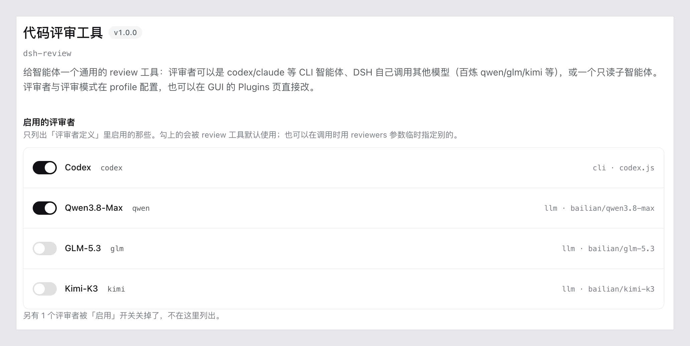

# dsh-review

[English](README.md) | **中文**

[](LICENSE)
[](https://github.com/deepseek-ai/deepseek-harness)
[](#安装)

代码评审不该绑死在一家身上。把改动交给一个 CLI 编码智能体，或交给一个跑 DSH 配置里模型的
子智能体——最后读一份合并好的结论。



## 它能做什么

- **两种评审者，都是真智能体。** `codex` / `claude` / `gemini` / `opencode` / `cursor`，或你
  自己拼命令行的任意 CLI；或者一个跑 DSH 配置里模型的子智能体。
- **多个评审者，一份报告。** 并行跑；每个评审者一节，按你勾选的顺序排列。
- **评审模式。** 强度与提示词起个名字（`quick`、`balanced`、`deep`……）配一次就能复用，
  不必每次重写评审要求。
- **在 GUI 里配置，而且自动保存。** 勾选要用的评审者，其余都收在「高级配置」里；停止输入约半秒
  后自动落盘，顶部会显示保存状态，最下面仍留一个「立即保存」按钮作手动重试。
- **不碰密钥、不碰端点。** provider 与凭据都留在你的 DSH 配置里，插件只用已经有的。

## 安装

clone 到一个长期保留的位置，然后装进 profile：

```sh
git clone git@github.com:yutingzhao1991/dsh-review.git ~/code/github/dsh-review
dsh plugin --profile web add ~/code/github/dsh-review     # web 换成你的 profile 名
```

也可以让智能体调 `plugin_manager` 的 `install_bundle`，`target` 传上面的绝对路径。

装完**重启宿主**。升级同理：`git pull` 之后重启。

需要 **DSH 0.2.1 或更新版本**。插件在 manifest 里用 `engines.dsh` 声明了这一点，旧宿主会直接拒绝
安装或激活，而不是等到真跑评审时才在子智能体启动那一步失败。

## 怎么用

```js
review()                                          // 用你启用的评审者，评审未提交的改动
review({ reviewers: ["codex", "deep-dive"] })     // 这次指定评审者
review({ mode: "deep" })                          // 深度模式：多个评审者
review({ base: "main" })                          // 工作区相对某个分支的改动
review({ commit: "abc1234" })                     // 某个提交引入的改动
review({ instructions: "只看并发与错误处理" })
```

评审要跑几分钟，所以调用默认**立即**把 job id 交回（不等）：用 `job_output` 读结论、
`job_kill` 终止，或者就等着——跑完会自动通知。

评审者是**显式启用**的：一个都没启用时，不带 `reviewers` 的调用会直接报错，而不是
悄悄把能用的都跑一遍。

## 评审者

| 类型 | 跑什么 | 自己会读代码吗 | 依赖 |
| --- | --- | --- | --- |
| `cli` | 你已经信得过的编码智能体 | 看预设（codex 会自己读仓库） | 本机装了那个 CLI |
| `subagent` | DSH 子智能体 | 会，它有工具 | 一个 subagent 服务（默认 `spawn`） |

CLI 预设：`codex`、`claude`、`gemini`、`opencode`、`cursor`，或 `custom` 自定义命令模板。

**CLI 装在哪**：插件按这个顺序找——`executable`（PATH 上的名字或路径）→ `~/.local/bin`、
`~/.bun/bin`、`/opt/homebrew/bin`、`/usr/local/bin` → **当前 profile 的依赖**（`node_modules/.bin/<名字>`，
以及预设声明的包内 bin，如 `@openai/codex` 的 `bin/codex.js`）。

最后那条是给你的建议路径：把 CLI 装成 profile 的**直接依赖**（`dsh plugin --profile <name> add <包名>`），
定位会一直有效。**不要再把绝对路径写进 patch**——本机就踩过这个坑：依赖重装把
`node_modules/@openai/codex` 裁掉后，钉死的绝对路径静默失效，工具描述还宣告它可用，
模型照着调用一路白跑。绝对路径仍然支持（优先级最高），但它的生命周期跟着依赖图走。

配置看着不对时先跑一次自检，别发起真评审：

```
review({ doctor: true })
```

它逐个检查可执行文件能否定位、来源是哪条候选、`--version` 能否跑起来、子智能体的 provider
是否注册，以及宿主有没有本插件依赖的 `startActivation()` 接口；还会报告 GUI 配置 schema
（`@deepseek-ai/schemastery`）是否解析到、来自哪里。不评审任何改动、不起评审者，也不需要 git 仓库。
子智能体的**模型连通性**不在自检范围内（那要真发一次请求）。

有一点值得知道：`subagent` 不写 `agentModel` 就会继承父会话的模型，所以它**不自动等于**「第二
意见」——想要独立意见就显式指定模型。

子智能体默认带 **30 分钟墙钟上限**（`timeoutMs` 按评审者覆盖；`hardTimeoutMs` 仍然限制整次调用）。
递归由宿主的委派深度预算兜底（默认 1），所以评审者通常无法再起子智能体。运行期间会报进度，
跑得久也不像卡住。

DSH 0.2.1 起，persona 与工具限制不再由子智能体启动请求传入：把它们配进一个 **Agent Preset**，
再用 `agentPreset` 选中。旧的 `persona` / `toolFilter` 会给出迁移告警，而不是静默失效。

这里刻意**没有**「把 diff 丢给一个裸模型」这种类型：能自己打开仓库的评审者，比只看到手头材料的
更有价值。

```yaml
- id: review
  name: dsh-review
  config:
    agents:
      - preset: codex
        model: gpt-5.6-sol
      - preset: claude
    reviewers:
      - id: deep-dive
        kind: subagent
        provider: spawn             # subagent 服务实现，默认就是 spawn
        agentProvider: bailian      # 你 DSH 配置里的任意 provider
        agentModel: deepseek-v4.1-flash
```

子智能体的模型同样来自你的 DSH 配置（provider、密钥、上下文窗口），GUI 里用**一个合并的模型选择器**
按 provider 分组列出已注册的那些，选中即同时写入 `agentProvider` 与 `agentModel`；插件里不复制任何一份。

`provider` 是 **subagent 服务实现**（默认 `spawn`），不是模型 provider——GUI 默认把它藏起来，
只有配成非 `spawn` 的值时才显示。

要指定 persona 或工具集，给该评审者加 `agentPreset: <preset-id>`：这些组合归 Agent Preset 管。
`spawn` 支持独立 preset；`fork` 会继承父会话的组合。

## 评审模式

一个模式就是一束「盯多严、额外说什么、用谁」。

| 字段 | 含义 |
| --- | --- |
| `strength` | `light` / `standard` / `deep`——内置的评审措辞 |
| `prompt` | 这个模式自己的评审指令 |
| `reviewers` | 这个模式用哪些评审者 |
| `when` | `always` / `complex` / `never`——给智能体看的评审策略 |

```yaml
config:
  defaultMode: balanced
  modes:
    balanced:
      strength: standard
      reviewers: [ codex ]
    deep:
      strength: deep
      reviewers: [ codex, deep-dive ]
```

一个模式都不配时，插件不追加任何约束——你继续用自己的提示词管智能体就行。`when` 只有在同时
打开 `injectPolicy: true` 时才生效，而且它只是写进系统提示词的要求，不是强制闸门。

## 配置项

所有配置都能在 GUI 里改；下面是同一批键在 YAML 里的样子，只列值得知道的：

| 键 | 默认 | 说明 |
| --- | --- | --- |
| `defaultReviewers` | 一个都没有 | 调用没给 `reviewers` 时用哪些；空 = 不启用任何评审者 |
| `defaultMode` | 不设 | 调用没给 `mode` 时套用的模式 |
| `language` | `auto` | `zh` / `en` / `auto` 报告语言（`auto` 跟随你的指令） |
| `injectPolicy` | `false` | 把各模式的 `when` 规则写进系统提示词 |
| `agents` / `reviewers` | `[]` | 定义 CLI 与子智能体评审者（`agents` 是预设简写，`reviewers` 是完整写法） |
| `modes` | `{}` | 命名评审模式 |
| `waitMs` | `0` | 调用阻塞多久后交回 job id。`0` = 立即交回（评审要跑几分钟，等着基本是白等） |
| `hardTimeoutMs` | `0` | 墙钟上限；`0` = 不限制——什么时候停由你决定 |
| `maxResultChars` | `80000` | 报告上限；超出会截断并给出完整报告路径 |
| `maxDiffChars` | `160000` | 需要 diff 的评审者能看到的变更正文上限 |

## 已知限制

- 评审始终在**会话工作目录**里跑，不能指向别的仓库。
- 一次调用只评一种范围（未提交 / 某个分支 / 某个提交），与底层 CLI 一致；`base` 与 `commit`
  互斥。范围 + `instructions` 对子智能体可用，但 codex 这类 CLI 不行（范围开关与 PROMPT 互斥）：
  选中的评审者全都是这种 CLI 时调用会被直接拒绝，否则在报告脚注里点名没收到关注点的那几个。
- 模式的提示词只在没给范围时才能到达 codex（它的 CLI 不允许两者同时出现）；范围永远生效，
  提示词被跳过时报告里会写明。
- codex 只在它信任的目录里能跑（`~/.codex/config.toml`）。
- `base`/`commit` 写了不存在的分支/提交会在起评审者之前直接报错，而不是跑几分钟再报一个
  「什么都没评」的批次。
- 报告骨架（标题、脚注、错误信息）目前固定中文；`language` 只影响评审者自己的指令。
- 被截断的报告留在 `$TMPDIR/dsh-review-*/report.md`；未截断的运行会自己清理。
- 工具描述里的评审者列表是**注册时**的快照：宿主不会因为 profile 的依赖变化而重载插件代码
  （实测 `patchReload: live` 只重载 patch 层），所以描述可能滞后于磁盘现状。要准的当前状态
  用 `review({ doctor: true })`。同一原因，改完插件代码需要重启宿主才生效。
- CLI 的结论取自 stdout 且 stdout 被截断（超过 `collectMaxBytes`）时，报告脚注会写明可能缺尾部
  并给出 spill 路径；找不到可执行文件时会列出所有尝试过的候选路径与各自失败原因。

## 开发

```sh
node selftest.mjs    # 用假宿主驱动插件：不需要 DSH、不跑 codex、不调模型
```

## License

[MIT](LICENSE)